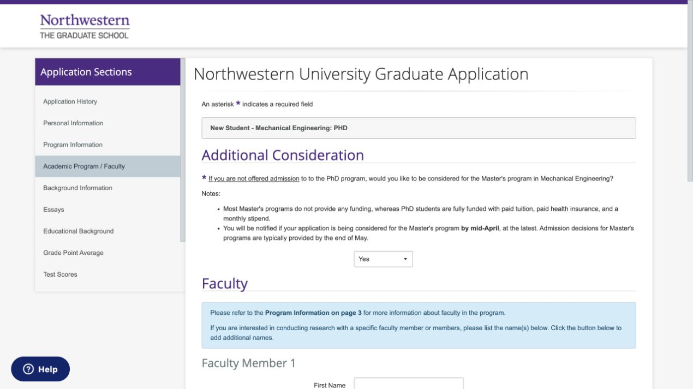
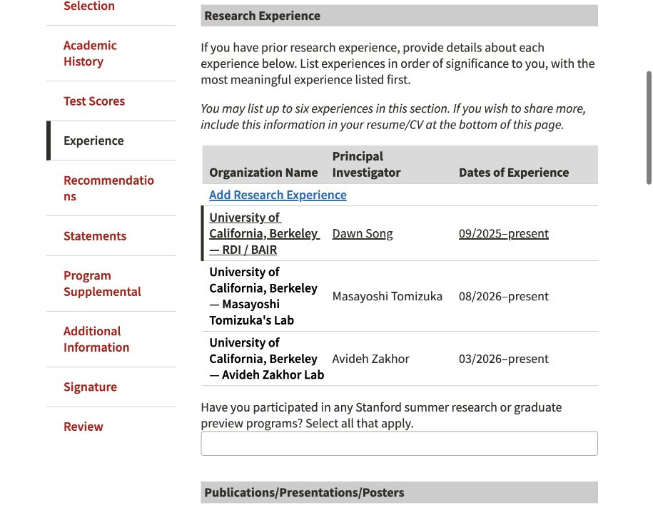

> 最新续填及纠正：见 [continued-filling-2026-11-21.md](continued-filling-2026-11-21.md)。UW 研究文字和 MIT 日期本轮已实际修复并重开验证；Northwestern 可从侧栏进入后续页，GPA 已保存。

# 六校申请表进展 — 2026-11-21

已按最新回答恢复登录并继续保存。六校均保持申请草稿，未最终提交、付款、上传材料或发送推荐邀请。Cornell 继续暂缓。登录密码未写入申请档案。

## 本轮最新结果

| 学校 | 已完成并保存 | 仍待处理 |
|---|---|---|
| Berkeley | 重新登录；San Jose 永久地址；性别 Man；处分问题 No；此前三段研究及个人资料保留 | 学历记录要求成绩单；EE/CS 最终方向、导师、文书待定 |
| Stanford | 重新登录；Male；San Jose 永久地址；处分及 academic probation 均 No；三段研究保留 | 学历记录需成绩单；导师与文书等待补 |
| MIT | 重新登录；最新研究日期/工时文字保存成功；RDI 任职起始月改为 2025-09；Male；父母研究生学历；永久地址；处分 No | 完整学历、学业需解释情况、导师、材料待补 |
| Princeton | 重新登录；南京永久地址保存；既有 Male、无学术/行为处分记录保留；父母学历已修正 | 完整学历、两篇教学/演讲短文、导师、材料待补 |
| UW | 重新登录；Male；San Jose 永久地址逐项保存并重开验证；此前 F-1、父母硕士及英语资格确认保留 | 完整学历、研究/导师排名、材料待补 |
| Northwestern | 门户恢复；硕士备选 Yes；无既往申请/就读/随导师转学均 No，重开验证；母语及两项 HackMIT 奖保存；推进到第 7 页 | 第 7 页缺精确到日的学历日期及成绩单，未通过完整性检查；导师及后续页待填 |

Northwestern 第 7 页已输入 Berkeley 院校、B.S.、EECS 和处分 No。由于日期和成绩单要求尚未满足，不能将该学历条目认定为完整保存或视为已解锁后续页。页面第 4 页的硕士备选和既往经历回答已单独保存并验证。

## 地址处理

- 通信地址：已确认的 San Jose 姨妈家稳定地址。
- Berkeley、Stanford、MIT、UW 永久地址：同 San Jose。
- Princeton 永久地址：按学校要求填写永久居住国家住宅地址，采用用户确认的南京地址；地区 Jiangsu Sheng，邮编 210028。
- Northwestern：保留已有南京永久地址。
- 以上分配根据用户“San Jose 姨妈家一直不会变、本人来自南京”和此前南京地址授权作出，操作前已告知用户。
- [邮编库](https://tw.youbianku.com/江苏省南京市栖霞区华电西路华电一宿舍20幢3单元105室) 给出的华电一宿舍区域邮编为 210028；来源街道写“华电西路”，用户已有申请地址写“红山路”，未擅自更改原街道。

UW 的“Same as Mailing Address”快捷操作起初没有持久保存，已改用逐项填写，保存后重新打开核验完整值。

## 用户最新确认的学历与研究资料

- De Anza、Foothill、Diablo、Evergreen：均仅修课，未取得 A.S. 学位。完整校名、日期、专业及 GPA 等成绩单到达后核对。
- RDI/BAIR：2025-09-20 开始，每天 4 小时；已告知按 28 小时/周填写。月份字段使用 2025-09。
- Tomizuka：2026-08 开始，5 小时/周。
- Zakhor：2026-03 开始，8 小时/周。
- 当前 F-1；父母均硕士；法定性别 Male；无任何处分或学术诚信记录。
- UW 满足本科学位就读期间全程美国居住要求。

三段研究分别已录入 Stanford Research Experience 和 Berkeley Employment。Princeton 保存 RDI 与 Tomizuka 两条，页面不再显示添加入口，完整列表留待 CV。MIT 三段研究文字已恢复保存，RDI Employment 的月份已修正；[本地文字副本](MIT/research-experience-latest.txt)。

## 学历/GPA注意事项

- MIT、Princeton、UW 已保存 Berkeley 本科记录：2025-08 至预计 2026-12，B.S.；成绩单尚未上传。
- Berkeley、Stanford 的院校弹窗要求成绩单，未成功建立本科条目；此前失败弹窗已取消。
- MIT、Princeton 累计 GPA 3.762/4.0。UW 字段拒绝三位小数，采用四舍五入的 3.76，已成功保存。
- Berkeley 专业 GPA 3.811 已保存；Advanced GPA 不根据不完整材料推算。
- MIT 专业下拉无精确 EECS，选最接近的 Electrical and Computer Engineering；Princeton 选 Computer Engineering。最终审阅核对，未拆成双专业。
- Northwestern 要求起止日期精确到日；等成绩单后提取明确学期信息。若成绩单仅给学期，需结合官方学期日历并明确标注推定，不能凭空填写具体日。

## 下一步

1. 等用户提供成绩单，读取各校真实课程、学期及成绩，核对非学位修课经历和 Berkeley 毕业时间。
2. 材料上传仍暂停；用户提供文件供查看并不自动等于授权上传。
3. 各校导师/研究方向排序尚未填写；Berkeley 最终 EE/CS 分支待选。
4. 各校 SOP、个人陈述、CV、推荐人、语言测试等尚未完成。
5. Princeton CS 两篇短文各 250 词，需要真实教学/辅导/演讲事例；Northwestern 学术陈述 500–1,000 词、个人陈述 125–250 词。
6. ALE 最新录用状态、GameDev 作者顺序仍待核对；Princeton 仅填经同行/编辑审查接收的作品。
7. MIT Academic Areas of Concern 与“无处分”是不同问题，暂未回答；其他未知可选背景信息仍留空。

## 本轮证据

### Northwestern 硕士备选

### 个人资料及地址

- [Berkeley](progress_evidence/berkeley-profile-saved.png)
- [Stanford](progress_evidence/stanford-profile-saved.png)
- [MIT](progress_evidence/mit-profile-saved.png)
- [Princeton](progress_evidence/princeton-address-saved.png)
- [UW](progress_evidence/uw-address-saved.png)

### 前轮已保存研究与学历

- [Berkeley 三段研究](progress_evidence/berkeley-research.png)
- [Princeton 研究任职](progress_evidence/princeton-research.png)
- [Princeton 本科学历](progress_evidence/princeton.png)

## Latest confirmed responses and MIT ELP requirements

Stanford two Additional Information answers No and Princeton two External Awards answers No saved and revisit-verified. User U.S. study start September 2023 confirmed. MIT waiver requires Medium of Instruction PDF and completed Academic History/transcripts, deadline November 25, 2026. Form opened, no upload or submission. Details: [MIT waiver instructions](MIT/english-waiver-instructions.md).

## Newly supplied transcripts

Evergreen Valley College and Diablo Valley College official transcripts received, issued 2024-12-20; each has one Fall2024 4-unit A course and 4.0 GPA. Read and visually checked, no uploads. Full attendance interval and DVC course-start month pending; see [transcript review](transcripts-reviewed-2026-11-21.md).
